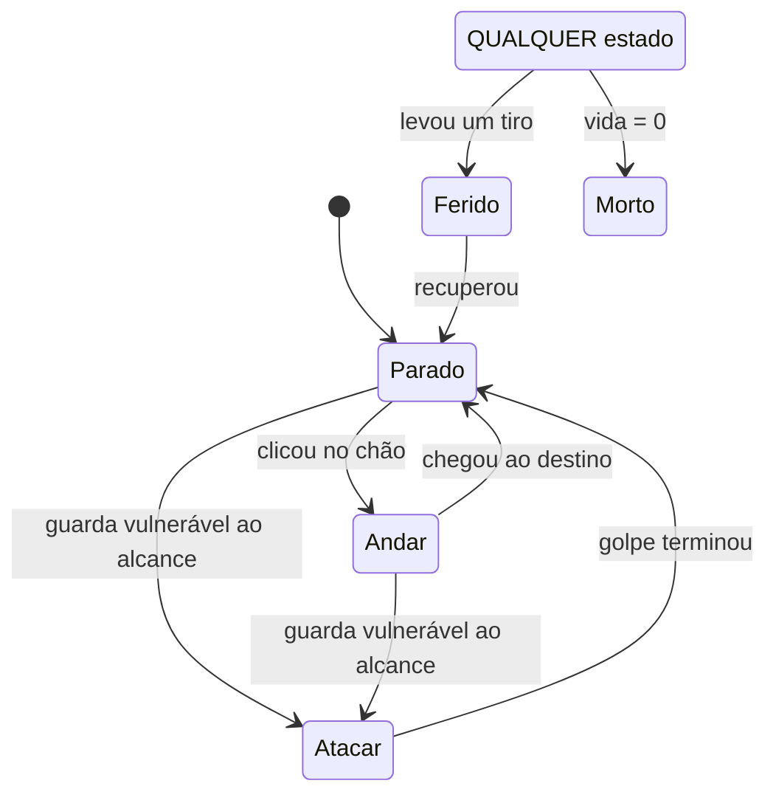
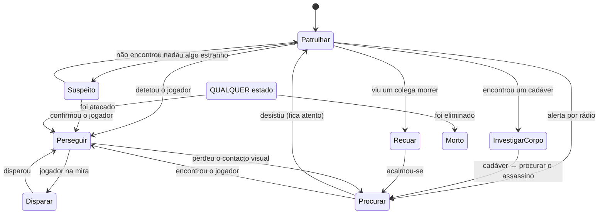
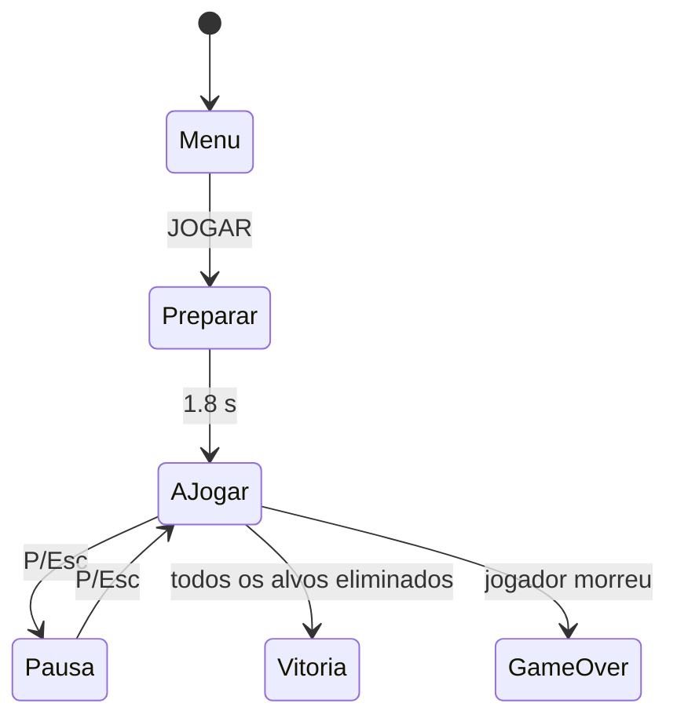

# Lâmina Silenciosa — Máquinas de Estados em Unity

Jogo **stealth top-down** (inspirado em *Hunter Assassin*, com arte própria) feito em Unity 6.3 (URP).
És um assassino com uma faca, num armazém às escuras: tens de eliminar todos os guardas sem seres apanhado
pelas lanternas deles. O **Player**, os **Guardas (NPCs)** e o **fluxo do jogo** são máquinas de estados (FSM),
todas com o **mesmo motor feito de raiz** (`StateMachine.cs`, sem bibliotecas externas).

---

## 1. Como jogar

1. Abrir o projeto `aula2011` no Unity (6000.3.24f1) e carregar em **Play** (funciona em qualquer cena).
2. No menu, escolher o nível e carregar em **JOGAR**.

| Controlo | Ação |
|---|---|
| **Clique esquerdo** no chão (ou manter e arrastar) | Mover — o trajeto aparece a pontilhado no chão |
| **Clique num guarda** | Persegue-o tentando chegar **por trás** dele |
| Chegar perto de um guarda **por trás ou pelo lado** | Ataque automático |
| P / Esc | Pausa |
| F1 | Painel das máquinas de estados |

**Não há habilidades de fuga** (o Dash foi removido): a sobrevivência depende do posicionamento e do stealth.

### Regras de stealth
- **Pela frente não dá:** dentro de 70° à frente do guarda não é possível eliminá-lo.
- **Pelas costas** (≥ 115°) = eliminação instantânea. **Pelo lado** = dano da faca (o guarda pesado aguenta).
- Guardas em **Alerta/Combate** só podem ser eliminados bem por trás (≥ 130°) e mais de perto.
- Não se pode atacar através de caixas/paredes. Tudo é **revalidado no momento do golpe**: se o guarda se virar a tempo → **FALHOU!**
- A **deteção é progressiva**: o medidor por cima do guarda enche enquanto te vê (mais depressa ao perto e se ele já estiver alerta).
- **Cadáveres** ficam no chão: se um guarda encontrar um, investiga, avisa os colegas por rádio e o **alerta da zona** sobe.
- Ser detetado é perigoso: os guardas disparam ~3 tiros/s e 4 tiros matam.

### Classificação de cada nível
Concluir o nível só exige eliminar todos os alvos. As estrelas premiam o stealth:
★ concluído · ★ todos os diamantes · ★ nunca detetado. Nota **S** = 3 estrelas e todas as eliminações silenciosas.

---

## 2. Arquitetura

```
Assets/FSM/
├── Core/StateMachine.cs        ← IState, State<TOwner>, StateMachine (o motor da FSM)
├── Player/PlayerController.cs  ← input do rato, caminho (NavMesh), escolha do alvo e FSM do jogador
├── Player/PlayerStates.cs      ← Parado, Andar, Atacar, Ferido, Morto
├── Enemy/EnemyAI.cs            ← perceção progressiva, níveis de alerta, cadáveres, vulnerabilidade + FSM do guarda
├── Enemy/EnemyStates.cs        ← Patrulhar, Suspeito, Investigar Corpo, Procurar, Recuar, Perseguir, Disparar, Morto
├── Enemy/GuardTypes.cs         ← enum GuardType + GuardProfile (atributos de cada tipo)
├── Enemy/GuardTypeSettings.cs  ← asset FSM_GuardTypes (editável no Inspector)
├── Enemy/GuardSquad.cs         ← "rádio": alerta da zona, cadáveres descobertos, procura coordenada
├── Enemy/Bullet.cs             ← balas dos guardas
├── Enemy/VisionConeVisual.cs   ← lanterna/cone de visão com a cor do estado
├── Game/GameManager.cs         ← FSM do jogo: Menu, Preparar, A Jogar, Pausa, Vitória, Game Over
├── Game/LevelRating.cs         ← estrelas, nota e pontuação
├── Game/Levels.cs              ← os 5 níveis (mapas em texto + percursos) e progresso guardado
├── Game/MenuUI.cs / DebugHUD.cs← menus, resumo do nível, HUD, medidores de deteção
├── Game/DemoBootstrap.cs       ← constrói o nível a partir do mapa
└── Visuals/…                   ← texturas, contornos, sangue, sons, personagens
```

### O motor (`StateMachine.cs`)
- **`IState`**: `Enter()`, `Tick()`, `Exit()`.
- **`AddTransition(de, para, condição, motivo)`** e **`AddAnyTransition(para, condição, motivo)`**.
- **`Tick()`** procura a primeira transição verdadeira → `SetState()` (Exit do antigo → Enter do novo).

---

## 3. Diagramas de estados

### Player


### Guarda — níveis de alerta
| Nível | Estados | Comportamento |
|---|---|---|
| **Normal** | Patrulhar | percurso desenhado no nível (ciclo ou vai-e-volta); depois de um alerta fica *atento* |
| **Suspeito** | Suspeito | pára, olha (tempo de reação), vai ver o local devagar, olha à volta |
| **Alerta** | Procurar, Investigar Corpo, Recuar | procura coordenada com os colegas; investiga cadáveres; testemunha pede reforços |
| **Combate** | Perseguir, Disparar | sistema de combate (inalterado) |



### Tipos de guarda (asset `Assets/FSM/Resources/FSM_GuardTypes` — editável no Inspector)
| Tipo | Vida | Velocidade | Visão | Reação | Extra |
|---|---|---|---|---|---|
| Normal | 100 | ×1 | ×1, 90° | ×1 | — |
| Pesado | 220 | ×0,75 | ×0,95, 80° | ×0,85 | aguenta golpes pelo lado; maior, ombreiras |
| Atirador | 90 | ×0,9 | ×1,35, 60° | ×1 | +4 m de alcance, antecipa o movimento; espingarda |
| Rápido | 70 | ×1,35 | ×0,9, 100° | ×1,4 | ouve mais longe; mais pequeno, boné |

### Jogo


---

## 4. Níveis
Legenda dos mapas (`Levels.cs`): `#` caixa alta · `B` caixas empilhadas · `o` caixas baixas (bloqueiam a passagem mas **não a visão**) ·
`P` jogador · `G` diamante · `E` normal · `H` pesado · `S` atirador · `F` rápido. Cada guarda tem um percurso em `Routes`.

| Nível | Guardas | Novidade |
|---|---|---|
| 1 Armazém | 2 normais | tutorial; diamante numa sala com uma só entrada |
| 2 Docas | 2 normais + rápido | caixas baixas não escondem |
| 3 Labirinto | 2 normais + rápido + pesado | pesado de posto fixo a guardar um diamante |
| 4 Fábrica | normal + rápido + pesado + atirador | atirador vigia o corredor de cima |
| 5 Quartel | 2 normais + rápido + pesado + atirador | todos os tipos e percursos cruzados |

---

## 5. Vídeos

**Vídeo 1 (jogo, F1 ligado):** menu → nível 1 → eliminar por trás (*SILENCIOSO!*) → tentar pela frente (não ataca) →
deixar um corpo à vista → outro guarda *Investigar Corpo* → *Procurar* com o alerta da zona a subir →
ser detetado (*Perseguir/Disparar*) → esconder-se → *Procurar* → *Patrulhar (atento)* → resumo com nota e estrelas.

**Vídeo 2 (código):**
1. `StateMachine.cs` — o motor.
2. `PlayerController.BuildStateMachine()` e `FindAttackTarget()`.
3. `EnemyAI.BuildStateMachine()` — as transições por nível de alerta (a ordem é a prioridade).
4. `EnemyAI.UpdatePerception()` — deteção progressiva; `CanBeAssassinatedBy()` — regras de stealth.
5. `EnemyStates.cs` — `EnemySuspiciousState`, `EnemyInvestigateCorpseState`, `EnemySearchState`.
6. `GuardSquad.cs` — coordenação por rádio e alerta da zona.
7. `GameManager.cs` + `LevelRating.cs` — o mesmo motor no fluxo do jogo e a classificação.
